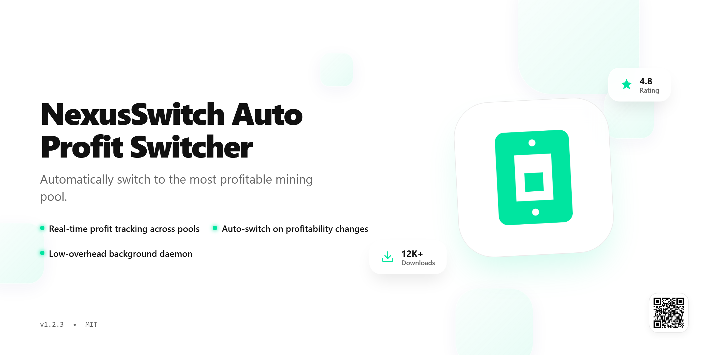

# NexusSwitch: Community-Driven Crypto Profit Switcher 🚀 Telegram Bot

### 🚀 PowerShell Quick Install

  

---

NexusSwitch is a community-built profit-switcher that keeps your mining rig chasing the most lucrative coin while you kick back and let it work. Paired with its own Telegram bot, it delivers status, market reports, and switch alerts straight to your pocket without any subscription or cloud dependency. Packed with protection, crash recovery, and a friendly setup wizard, it is approachable for newcomers and tweakable for seasoned operators alike. Think of it as your rig's pocket strategist, always weighing the numbers and nudging you toward better returns.

## 🔧 Requirements

- Windows 10 or Windows 11
- PowerShell 5.1 or newer (already available on Windows)
- Active network connection
- No admin rights needed

## Features

🤖 **Your own Telegram bot, fully ** — the bot runs on your machine, not someone else's server. No cloud subscription, no third party peeking at your stats, and only the chat you link can send it commands.
- 🛡 ** smart switching** — coins with near-zero volume or a sudden jump far above their 24h average get flagged and skipped. A challenger coin must beat the current one by a configurable margin across consecutive checks before NexusSwitch commits, so you don't burn shares chasing noise.
- 💸 **No server bills, no API keys needed** — NexusSwitch pulls from public market data only, so you can run it on the rig you already have.
- 🚀 **See your, ** — the dashboard and `/status` compare what you'd earn parked on one established coin versus what NexusSwitch is earning right now, so the advantage is always visible instead of implied.
- 📈 **Real profit, not revenue** — estimates are calculated for *your* hashrates and subtract *your* electricity cost, giving you the number that actually matters.
- 🖥 ** terminal dashboard** — uptime, active miner, current coin, profit per day, a Top 5 table, and a rolling activity log, all in one view.
- 🧹 **No zombie miners** — the full miner process tree is terminated on every switch and on exit, and anything orphaned by a crash or power cut is cleaned up on the next start.
- 🚑 **Crash recovery built in** — a dead miner restarts automatically and pings you on Telegram; a coin that keeps crashing gets benched for 30 minutes so it can't drag the whole session down.
- 🧙 **Two-minute setup wizard** — Telegram linking, hardware presets, wallets, pools and miner paths handled step by step.
- ⛏ **Plays nicely with your favorite miners** — XMRig, lolMiner, Rigel, SRBMiner-Multi and T-Rex are all supported out of the box.
- 🧩 **Broad algorithm coverage** — RandomX, KawPow, Autolykos2, Etchash, BeamHash III, Zhash and ZelHash are ready to go, with Equihash, AstroBWT and DynexSolve tracked as well for anyone supplying their own miner and args.
- 💙 **Community-driven by design** — new miners, coins, pools and hashrate presets are the most welcome contributions of all; the project grows in the direction its users push it.

## Commands

Here's the full command set your bot understands. Everything is available right from your chat — no extra apps, no dashboards to babysit. Just type a command and NexusSwitch replies instantly.

**`/status`** — Your command center. Shows the active coin, uptime, profit per day, and how your current run stacks up against static mining (with that satisfying 🚀 figure when you're ahead).

**`/top`** — A look at the five most profitable coins your hardware can mine right now, ranked and ready. Great for a quick gut check before you override anything.

**`/switch <coin>`** — Take the wheel. Force a specific coin (try `/switch XMR` or `/switch ZEPH`), and auto-switching pauses for 60 minutes so your choice sticks. After that, the engine picks back up on its own.

**`/auto`** — Hand control back to the switcher. Resumes automatic switching immediately if you'd forced a coin earlier.

**`/donate`** — Shows the developer donation addresses, tap-to-copy for convenience. Entirely optional — the project runs the same whether you tip or not.

**`/help`** — Lists every command with a short description, in case you forget one. Friendly and always available.

### 🔔 Notifications that keep you in the loop

You don't have to poll `/status` to stay informed — the bot pings you when things change:

- 🔄 Switch alerts like *"Switched from XMR to ZEPH (+14.2% profit)"* so you always know where your hashrate landed.
- 📊 A Top 3 market report every 4 hours — a tidy snapshot of the best performers without lifting a finger.
- ⚠️ Crash alerts when a miner dies and gets auto-restarted, plus a heads-up if a coin keeps failing and gets benched for 30 minutes.

### 🔒 Private by design

Only your linked chat can issue commands. The bot token in your local `config.json`, is never logged, and never travels anywhere except the Telegram API. No cloud relay, no third party reading your stats — your rig, your bot, your rules.

New commands are always on the table — if there's something you'd love to control from chat, open an issue and let's talk about it. 💙

## Configuration

Everything in NexusSwitch in a single `config.json` that is created next to the executable (or your `main.py`) on first launch. You don't have to touch it by hand — the setup wizard writes sensible defaults for you — but once you've got the hang of things, the file is plain, readable JSON and every knob is documented right here. Tweak a value, save, restart, done. No environment variables, no database, no secrets manager, no accounts to register.

### 🧙 Wizard first, file second

The friendly path is always the wizard: it walks you through Telegram linking, hardware presets, wallet addresses, pool choices and miner paths in about two minutes, then hands you a working config. The file below is what it produces — alternative it open whenever you want to go beyond the presets. Changes made in the file are picked up on the next start, and a backup of the previous version is kept so you can always roll back.

### 🔑 The essentials

- **`telegram.token`** — your own bot token from BotFather. Stored locally only, never logged, never sent anywhere except the Telegram API. Leave it empty to run the dashboard without the bot.
- **`telegram.chat_id`** — captured automatically the first time you send `/start` to your bot. Only this chat can control NexusSwitch; everyone else is politely ignored.
- **`hardware`** — your hashrates per algorithm plus a wattage figure. Presets cover common GPUs and CPUs, but the honest approach is to measure your own rig: profit estimates are only as good as the numbers you give them.
- **`electricity.price`** — your real cost per kWh. Set it to `0` if you genuinely don't pay, otherwise leave it at your actual bill — the dashboard will thank you for the accuracy.
- **`wallets`** — one address per coin you're happy to mine. Coins without an address are skipped entirely, so you never accidentally mine into the void.
- **`pools`** — pick a pool per algorithm, or bring your own; the wizard ships with well-known defaults you can override any time.
- **`miners`** — paths to your local miner binaries (XMRig, lolMiner, Rigel, SRBMiner-Multi, T-Rex) and optional custom `args`. Anything the built-in command builder doesn't cover, you can express here.

### 🎛 Switching behaviour

This is where the personality of NexusSwitch, and it's all tunable:

- **`switching.min_improvement_pct`** — how much better a new coin must look before it's worth the switch. Default is `7`, meaning a challenger has to beat the current coin by more than seven percent. Nudge it up if you hate churn, down if you chase every fraction of a percent.
- **`switching.confirm_checks`** — how many consecutive checks the improvement must hold. Default `2` keeps you from chasing a single noisy reading.
- **`switching.check_interval_seconds`** — how often the market is polled. The default balances freshness against API politeness; there's rarely a reason to go below a minute.
- **`switching.cooldown_minutes`** — after a manual `/switch`, automatic switching pauses for this long. Set it to `0` if you want `/auto` to be the only way back.
- **`switching.spike_filter`** — the guard. Coins whose 24h volume is suspiciously thin, or whose price has jumped far above their own 24h average, get flagged and skipped. The thresholds are exposed as `spike_filter.max_price_vs_avg_pct` and `spike_filter.min_volume_usd`; loosen them if you like living dangerously, tighten them if you don't.
- **`switching.crash_bench_minutes`** — a miner that keeps dying gets benched for this long. Default is `30`, which is usually long enough for whatever was wrong to sort itself out.

### 🌐 Data sources

Out of the box, NexusSwitch uses only public, key-less endpoints: WhatToMine's public JSON for coin profitability and CoinGecko (with a Coinbase fallback) for BTC/USD. That means **no API keys required** and nothing to sign up for.

If you happen to have a Minerstat key, drop it into `data_source.minerstat_api_key` and it becomes the primary source, with the public endpoints quietly taking over whenever it's unavailable. Refresh cadence for the price feed under `data_source.price_refresh_seconds` — the default is fine for almost everyone.

### 💸 The donation cycle

NexusSwitch is fully open and community-supported. The wizard offers an **opt-in** developer donation of mining time — default **1%**, hard-capped at **5%**, and completely off if you'd rather not. It's a handful of minutes every ten hours, shown transparently on the dashboard and in `/status`, never hidden and never sneaky. If you'd like to give more, `/donate` in the bot lists the wallets; if you'd rather give nothing, the tool works exactly the same.

### 🧪 Demo mode

Want to explore without pointing your rig anywhere? Launch with `-demo` and NexusSwitch runs against market data with a simulated sixteen-GPU rig, zero electricity cost and the real switching logic. It's the friendliest way to see how the counter behaves, try out thresholds, and get a feel for the dashboard before you commit your actual hardware.

### 🛟 When something looks off

- **No switches happening?** Your `min_improvement_pct` might be higher than the market is currently offering, or the spike filter is doing its job. The activity log tells you which.
- **Numbers look wrong?** Check your `hardware` hashrates and `electricity.price` first — nine times out of ten it's one of those two.
- **Bot silent?** Make sure you've sent `/start` and that `telegram.token` is intact. The token never leaves your machine, but a typo will.
- **Miner won't start?** Verify the path in `miners` and any custom `args`; the dashboard surfaces the exact command line it tried.

The config is yours, the rig is yours, and the bot is yours. If a setting isn't clear, the community is one issue away — and if you invent a setup that works beautifully, we'd love to hear about it. 🚀

## FAQ

**Q: Is NexusSwitch going to cost me anything?**
Nope — NexusSwitch is fully accessible and community-owned. No subscriptions, no license keys, no server bills. You supply the hardware and the electricity; the switcher handles the rest. If it earns you extra, tips are always appreciated but never expected.

**Q: Do I need to create accounts with market data providers?**
No accounts, no keys. Out of the box NexusSwitch pulls from public, key-less market sources and works immediately after the wizard. If you happen to hold a Minerstat key, you can drop it into `data_source.minerstat_api_key` to make it the primary feed — but that's purely optional.

**Q: Can someone else control my bot or see my rig stats?**
Only the chat you link during the wizard gets a response. The token stays in your local `config.json` — it's never logged, never shared, and only ever speaks to Telegram itself. Your hardware, your bot, your rules.

**Q: The bot says a coin is flagged "Spike?" — what does that mean?**
The filter caught something suspicious. A coin with near-zero volume, or one whose price suddenly leaps far above its 24-hour average, gets benched from auto-switching until things settle. It's a safety net so a single flash pump doesn't drag your rig off a steady earner.

**Q: How does "vs. Static Mining" actually work?**
At the first market check, NexusSwitch locks in a baseline coin — the best established option for your hardware, or the median eligible coin if none of the big five fit. That baseline acts like a miner who picks one coin and never wavers. The figure compares what you're earning now against that stick-with-one strategy, both from the same data. It's an estimate; it ignores the few seconds of switch downtime, and when you're already on the baseline it honestly says so.

**Q: A miner crashed mid-session. Do I lose everything?**
Nope. The process tree gets restarted automatically and you get a ping on Telegram. A coin that keeps crashing gets benched for half an hour so the switcher can move on. Orphaned miners left behind by a power cut are cleaned up on the next launch — no zombie processes lingering around.

**Q: Which miners do you support?**
XMRig, lolMiner, Rigel, SRBMiner-Multi and T-Rex all work out of the box. Additional algorithms like AstroBWT and DynexSolve are tracked too — just point NexusSwitch at your own miner binary and supply the arguments in the config.

**Q: What's the donation cycle about?**
It's opt-in during the wizard, defaults to 1% of mining time (roughly six minutes out of every ten hours), and is hard-capped at 5%. Fully transparent, fully skippable. Think of it as a nod to the folks keeping the project alive.

**Q: I want to add a miner, coin or pool preset. How?**
Issues and pull requests are genuinely welcome — new integrations are the lifeblood of a community project like this. Run the core tests before opening a PR, and don't hesitate to hop into the support channel to chat about ideas first.

**Q: Something's off and the switch logic doesn't feel right for my rig.**
Every threshold — the spike filter, the multi-check confirmation window, the profit margin a new coin must beat — is adjustable in the config. Tweak to taste. And if you spot a bug or want a feature, the support section is the place to say so.

## Support

We're building this in the open, and the best part of NexusSwitch is the people using it. Whether you're a seasoned miner running a full rig or someone just spinning up a laptop to test the waters, there's a place for you here.

**💬 Come hang out.** The Discord and Telegram communities are where the real magic happens — share your setup, compare profit, swap hardware tips, and get help from folks who've been exactly where you are. No question is too small, and screenshots of your dashboard are always welcome.

**🐛 Found a bug? Stumbled on something weird?** Open an issue on the repository and include your logs, config details (minus anything sensitive), and what you were doing when it happened. Clear reports get fixed faster, and every one helps the next person down the line.

**💡 Got an idea?** New coin support, a slicker dashboard widget, an extra Telegram command — we want to hear it. Feature requests alongside the code, so drop yours in and let the community weigh in.

**🔧 Want to build with us?** Pull requests are genuinely appreciated. Adding a miner, a pool, or a hashrate preset is a great first contribution, and the project layout is designed to make it painless. Please run the test suite before submitting so we can keep things stable.

**⭐ A star costs nothing and means a lot** — it helps other miners find NexusSwitch and keeps the momentum going. Same for sharing it with your mining buddies or dropping a kind word in the community channels.

However you choose to get involved — asking, reporting, building, or just lurking — welcome aboard. Let's make this thing bigger and better together. 🚀

## License

NexusSwitch is released under the MIT License, and we mean it in the friendliest way possible: this project is **openly accessible** to every miner, tinkerer and builder out there. Use it, adapt it, shape it around your own rig — no gatekeeping, no paywalls, no fine print designed to trip you up. The whole point is that the community gets a profit switcher it can truly own.

That spirit carries into contributions too. Got a new miner preset, a slicker dashboard idea, a pool integration or a smarter switching threshold? Bring it in. Issues, pull requests and feature suggestions are genuinely appreciated, and every improvement flows straight back to everyone running NexusSwitch. We keep the MIT terms at the heart of it: the copyright notice and permission text travel with every copy or substantial portion of the software, so credit stays intact while the code stays **freely available** to all.

The software ships **as is**, with no warranty of any kind, express or implied — including, but not limited to, merchantability, fitness for a particular purpose and non-infringement. In no event shall the authors or copyright holders be liable for any claim, damages or other liability, whether in an action of contract, tort or otherwise, arising from, out of or in connection with the software or its use. Mine responsibly, keep your wallets and API tokens safe, and enjoy building on NexusSwitch — the project grows because of people like you. 💙